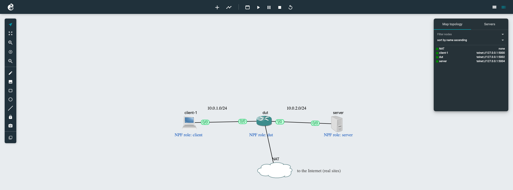
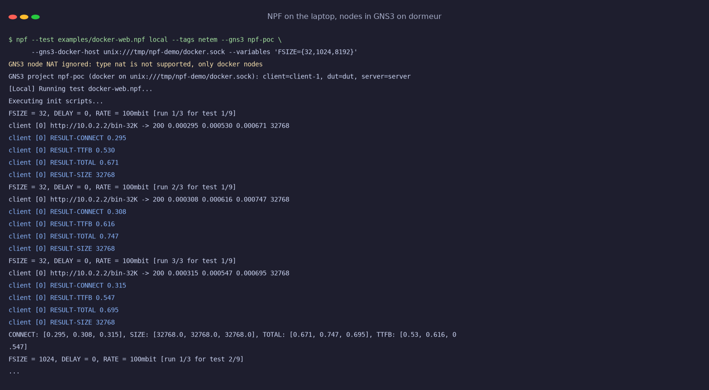
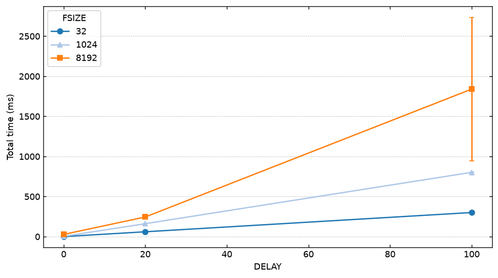
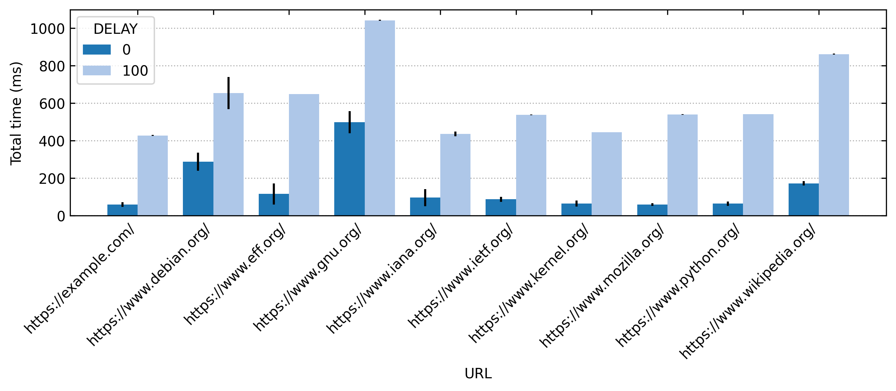

# Demo: an NPF test on a remote GNS3 testbed

This folder deploys a GNS3 server on a Linux machine, builds a small testbed in it, and runs
`examples/docker-web.npf` on that testbed from a laptop. The general GNS3 → local → remote → real chain is described in
[../docker-testbed/README.md](../docker-testbed/README.md). This page is the worked example, run on `dormeur`
(Ubuntu 22.04, reached through two ssh jump hosts) from a Mac.

| File | What it does |
| --- | --- |
| `deploy-server.sh` | Installs gns3-server 2.2.x and ubridge under `/opt/gns3`, as a systemd service listening on 127.0.0.1:3080 |
| `poc.py` | Creates the `npf-poc` project through the REST API: client, DUT and server Docker nodes, and a NAT uplink |
| `figures.py` | Renders captured terminal output (and, without a browser, the project topology) as PNG |
| `demo/` | The screenshots and graphs below |

## 1. Deploy the GNS3 server

```sh
ssh dormeur 'bash -s' < examples/gns3/deploy-server.sh
ssh -N -L 3080:127.0.0.1:3080 -L /tmp/npf-demo/docker.sock:/var/run/docker.sock dormeur &
```

The API has no authentication, so it only listens on loopback and is reached through the ssh tunnel. The second
forward gives the laptop the Docker daemon of `dormeur`. `--gns3-docker-host ssh://dormeur` does this by itself (one
ssh connection for the whole run), the explicit socket is only needed when the ssh route must be tuned by hand.

## 2. Build the node image and the project

```sh
DOCKER_HOST=unix:///tmp/npf-demo/docker.sock docker build -t npf-node examples/docker-testbed
python examples/gns3/poc.py --recreate
```

The project as seen in the GNS3 web UI (<http://127.0.0.1:3080/static/web-ui/bundled> through the tunnel), captured
while NPF was running a test on it. Node names give the NPF roles: `client-1` is role `client`.



The DUT routes between 10.0.1.0/24 and 10.0.2.0/24 and masquerades the client's traffic to the NAT node for the
real-site runs. The same topology can be drawn by hand in the GNS3 GUI, `poc.py` only makes the demo reproducible.

## 3. Run A: synthetic server, delay × file size

```sh
npf --test examples/docker-web.npf local --tags netem --gns3 npf-poc \
    --gns3-docker-host unix:///tmp/npf-demo/docker.sock --variables 'FSIZE={32,1024,8192}'
```

NPF lists the project, maps nodes to roles, copies the test files into the containers (they do not share any folder
with the laptop) and runs the scripts with `docker exec`:



The client fetches a file of FSIZE KB from the nginx server, through the DUT, with `tc netem` adding DELAY ms on the
client link. 9 points × 3 runs, all 27 fetches succeeded:



The time grows with the number of round trips TCP needs at each size (slow start). The large error bar at 100 ms and
8 MB is one run out of three that took 3.1 s instead of 1.2 s, most likely a retransmission timeout.

This run was made before RATE was fixed: netem was only on the client's egress, so RATE shaped the requests and ACKs
but not the download (8 MB at DELAY 0 took 28 ms, about 2.4 Gbit/s). The test now also shapes the client's ingress
through an ifb device: on this testbed 8 MB takes 3.51 s at RATE=20mbit (3.36 s in theory) and 0.70 s at 100mbit.
Where ifb is not available (Docker Desktop), it polices the download instead, which only approximates RATE.

## 4. Run B: real websites through the same testbed

```sh
npf --test examples/docker-web.npf local --tags real netem --gns3 npf-poc --gns3-start --gns3-keep \
    --gns3-docker-host ssh://dormeur --variables 'DELAY={0,100}' --config n_runs=2
```

With `--tags real` the server node is not used: the client fetches each URL of
[../docker-testbed/sites.txt](../docker-testbed/sites.txt) (`URL=FILE(docker-testbed/sites.txt)` in the test), through
the DUT and the NAT node. `--gns3-docker-host ssh://dormeur` forwards the remote Docker socket over one ssh
connection, without the manual tunnel of step 1. All 40 fetches succeeded:



With 100 ms added, the time to first byte of most sites is about 420 ms: four round trips (DNS, TCP, TLS 1.3 and the
request). The total grows by 370 ms (example.com) to 690 ms (wikipedia.org, 120 KB): larger pages need more round
trips to download.

Before this run, the client node had been up for 8 hours and had lost its link: `eth0` was gone, NPF printed
`WARNING: could not list the interfaces of container ...` and every fetch failed with curl code 000. Reloading the node
did not help, stopping and starting it in GNS3 did. On a first start, the DUT may also need a few seconds to get its
DHCP lease on the NAT link: `--gns3-start` waits for GNS3 to report the nodes as started, not for their start command
to finish.

## Notes

- GNS3 projects close when the last GUI or web UI client disconnects (`auto_close`), which stops all their nodes. With
  `--gns3-start`, NPF turns this off for the duration of the test and restores it at the end, so you can watch the
  project in the web UI while a test runs. `poc.py` creates the project with `auto_close` off.
- Without a browser, `python examples/gns3/figures.py topology npf-poc topo.png` draws the project from the API.
- Stop the nodes with the stop button of the web UI, or
  `curl -X POST http://127.0.0.1:3080/v2/projects/<project id>/nodes/stop -d '{}'`.
